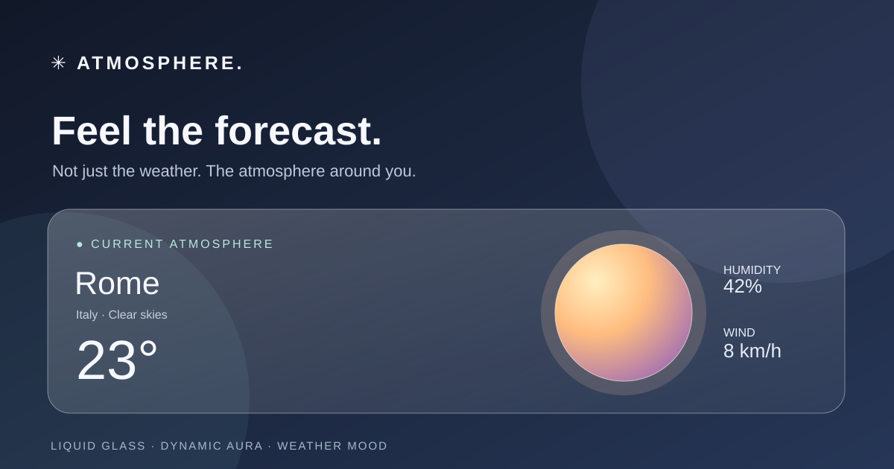

# Atmosphere — Weather, reimagined

A responsive weather dashboard built with **HTML, CSS and vanilla JavaScript**. Atmosphere combines a translucent, liquid-glass interface with live weather conditions and a distinctive animated weather aura.

## Features

- Search current conditions by city, with shortcuts for Berlin, Rome and Tokyo
- Weather-aware animated aura with daylight and nighttime palettes
- Weather Mood: short atmospheric descriptions informed by current conditions
- Temperature, feels-like temperature, humidity, wind, visibility and pressure
- Responsive layouts, accessible status messaging and reduced-motion support
- Live conditions powered by [WeatherAPI](https://www.weatherapi.com/)

## Run locally

1. Clone this repository.
2. Open `index.html` in a browser.
3. Enter a city or use a shortcut.

> **API security:** The current demo uses a browser-side API key already present in the original project. Browser-side keys are publicly visible. Before production deployment, rotate that key and send weather requests through a server-side proxy with the new key stored as a server environment variable.

## Project files

- `index.html` — layout and semantic structure
- `style.css` — responsive interface, glass surfaces and animated weather aura
- `main.js` — API request, dynamic colors, city search and conditions
- `images/atmosphere-github-cover.svg` — GitHub project cover

## Portfolio

A dedicated 1536 × 508 portfolio cover is available separately for use on the portfolio website.
